<div align="center">

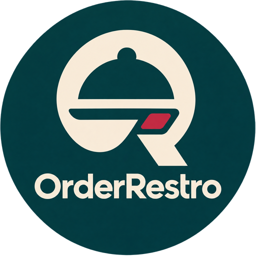


**Open-source, self-hosted restaurant POS & management system** — billing
with **UPI QR payments**, tables, kitchen display (KDS), reservations,
inventory, **staff attendance & payroll**, accounting, reports, CRM/loyalty
and multi-branch control. Offline-first, runs on your own server, no
subscription. Not a retail POS bolted onto a restaurant; purpose-built for
dine-in, takeaway, delivery and kitchen operations.

[](./LICENSE)
[](package.json)
[](pnpm-workspace.yaml)
[](apps/web/tsconfig.json)
[](apps/backend)
[](apps/web)
[](casaos/README.md)
[](./CONTRIBUTING.md)
[](./ROADMAP.md)
[](https://github.com/sponsors/Raktim94)

Developed by [NodeDR Infotech Private Limited](https://www.nodedr.com/)

**[Try OrderRestro](https://orderrestro.nodedr.com/)** · **[Case study](https://www.raktimranjit.com/projects/orderrestro)** · **[Maintainer: Raktim Ranjit](https://www.raktimranjit.com/)**

<p align="center">
  <a href="https://orderrestro.nodedr.com/"></a>
  <a href="https://play.google.com/store/apps/details?id=com.nodedr.orderrestro&pcampaignid=web_share"></a>
</p>

<p align="center">
  
</p>


[Install](#install-orderrestro) ·
[Quick Start](#quick-start) ·
[How to use](#how-to-use-orderrestro) ·
[Full tutorial](./TUTORIAL.md) ·
[Features](#features) ·
[Screenshots](#screenshots) ·
[Docs](#documentation) ·
[Contributing](#contributing) ·
[Roadmap](./ROADMAP.md)

</div>

---

## Install OrderRestro

Pick the one that fits. The server (back office, tills, kitchen display) runs on a PC, mini PC, NAS or VPS; the phone app connects to it or works offline on its own.

| Where | Install |
| --- | --- |
| **Android phone / tablet** | [Get it on Google Play](https://play.google.com/store/apps/details?id=com.nodedr.orderrestro&pcampaignid=web_share) (package `com.nodedr.orderrestro`) |
| **Ubuntu / Debian server** (amd64, arm64) | `curl -fsSL https://orderrestro.nodedr.com/install-linux.sh \| sudo bash`, then open `http://<server>:1995` |
| **Any Linux / macOS / WSL2 with Docker** | `git clone https://github.com/Raktim94/nodedr-restaurant-pos.git && cd nodedr-restaurant-pos && ./install.sh` |
| **CasaOS / ZimaOS** | App Store, then **Install a customized app**, and paste `https://raw.githubusercontent.com/Raktim94/nodedr-restaurant-pos/master/casaos/docker-compose.yml` ([steps](casaos/README.md)) |
| **Windows 10/11** | [Get it from the Microsoft Store](https://apps.microsoft.com/detail/9NRG9BVFCMN5), or run `winget install --id 9NRG9BVFCMN5 --source msstore` in PowerShell ([build notes](windows/msix/README.md)) |
| **Downloads and checksums** | [Latest release](https://github.com/Raktim94/nodedr-restaurant-pos/releases/latest) (`.deb` for amd64 and arm64, with `.sha256` files) |

After the server is up, open it in a browser and create your restaurant at `/signup`. Details, Docker setup and manual install are in [Quick start](#quick-start).

## Integrate with AI Coding Agents

Building a restaurant website or app on OrderRestro? Point your coding agent at [`prompts/AI_INTEGRATION_PROMPT.md`](prompts/AI_INTEGRATION_PROMPT.md) (verified endpoints, scopes, server-side Next.js pattern, MCP setup, test checklist). See also [`AGENTS.md`](AGENTS.md) and [`llms.txt`](llms.txt).

## Watch OrderRestro on YouTube

[](https://youtu.be/L7nXdduvExc)

See the full walkthrough, from setup and menu pricing to orders, kitchen service, and reports.

## What this is

**Nodedr OrderRestro** is a purpose-built, offline-first Restaurant
Management System for restaurants, cafés, coffee shops, bakeries, fast
food, fine dining, bars, food courts, cloud kitchens, and multi-branch
chains. The whole stack — Postgres, API, and web app — runs on one local
server on the restaurant's own LAN: order-taking, billing, KDS, and
printing all keep working with the WAN cable unplugged. No subscription,
no forced cloud dependency, self-hosted by design.

It's a sister project to [`nodedr-pos`](https://github.com/Raktim94/nodedr-pos)
(the retail-shop POS), reusing its proven patterns — auth/session model,
receipt rendering, ESC/POS printing, currency-rounding discipline — but
built as its own codebase, because restaurant floor/kitchen/reservation
operations and retail shop billing are different enough domains that
forcing one schema to serve both would have compromised both. See
[`PROJECT.md`](./PROJECT.md) for the full rationale.

**Non-negotiable product principles** (the short version — full detail in
[`PROJECT.md`](./PROJECT.md)):

1. **Offline-first / self-hosted** — a single branch runs entirely on a
   local LAN server, zero internet dependency once installed.
2. **Premium, not "POS-ugly"** — every screen is held to the same bar as
   Stripe Dashboard, Linear, Notion, Vercel, Shopify Admin.
3. **RBAC everywhere** — every action gated by a granular, individually
   toggleable permission, never a hardcoded role check.
4. **Modular / plugin-ready** — 20 product domains that can evolve
   independently.
5. **Server-authoritative money** — all pricing, tax, discount, and
   loyalty math computed server-side, never trusted from the client.

## Where to run it

"Offline-first" describes how the app runs, not where it has to live —
nothing about it is tied to a specific machine or network:

- **A local LAN server (the default, recommended setup).** One machine in
  the restaurant runs `docker compose up`; every till, tablet, and KDS
  screen on the same Wi-Fi/Ethernet reaches it at `http://<that machine's
  LAN IP>:1995`. No internet connection is needed once it's running —
  order-taking, billing, KDS, and printing all keep working with the WAN
  cable unplugged.
- **Any VPS or cloud box.** The identical `docker compose up` also runs
  unmodified on a VPS (DigitalOcean, Hetzner, AWS, etc.) if you'd rather
  manage one restaurant — or several branches — remotely instead of on
  site. Point `FRONTEND_ORIGIN`/`HOST_PORT` in `.env` at that box instead
  of `localhost`; nothing else changes.
- **Behind a tunnel (Cloudflare Tunnel, ngrok, Tailscale Funnel, or any
  reverse proxy).** Reachable from outside the LAN with a real HTTPS
  certificate and no port-forwarding, by pointing the tunnel at the `web`
  service's port (`1995` by default). Once traffic reaches the app over
  `https://`, set **`COOKIE_SECURE=true`** in `.env` so the session cookie
  is marked `Secure` — leave it `false` (the default) for a plain
  `http://` LAN/VPS setup, since a browser silently refuses to store a
  `Secure` cookie on a non-HTTPS origin, which locks every user out with
  "Unauthorized" even though login appears to succeed.

Whichever way you reach it, it's the same three containers, same data, same
login — there's no separate "cloud" mode to configure.

- **CasaOS / ZimaOS.** Pre-built, multi-arch (amd64/arm64) images are
  published to GHCR and there's a ready-to-install app manifest — no build
  step, no `git clone` needed. Install directly from a compose URL today;
  see [`casaos/README.md`](casaos/README.md). Official app store submission
  pending.

### Windows desktop client

However you host the server above, tills that are Windows machines don't
have to use a browser tab: `windows/msix/` packages a thin native client
(WinForms + WebView2, not Electron — no bundled Chromium, no server, no
Docker) with a Start Menu entry that points at your server's address and
otherwise just shows the same web UI. See
[`windows/msix/README.md`](windows/msix/README.md) for what it is/isn't,
build instructions, and the full capability list.

Status: the build, package, install, and Start Menu registration are all
machine-verified on every push via GitHub Actions (`windows-msix.yml`,
real `windows-latest` runner) — not just "it compiled." What that CI run
does **not** cover: a physical Windows machine (Start Menu tile look,
taskbar icon, DPI scaling, upgrade-in-place), a real thermal printer, or
Microsoft Store certification (WACK) — see `windows/msix/README.md` and
[`SECURITY-AUDIT-REPORT.md`](./SECURITY-AUDIT-REPORT.md) for the full
verified-vs-not-tested breakdown before relying on it in production.

## Features

Full field-level detail for every module lives in [`ROADMAP.md`](./ROADMAP.md).
This is the complete 20-module scope from the original brief — **not**
all built yet; ✅ = done and verified end-to-end, 🚧 = planned, sequenced
by phase.

| | Module | Status |
|---|---|---|
| 1 | POS & Billing — dine-in/takeaway, bill merge, **split bill by guest (by line or quantity)**, several payment methods on one bill, multi-region tax (India GST, US Sales Tax, EU VAT, Spain IVA), discounts, gift cards, tips, payments, refunds; see [docs/SPLIT-BILLING.md](docs/SPLIT-BILLING.md) | ✅ |
| 2 | Table & Reservation Management — visual floor plan with saved layouts, bulk table tools, booking, waitlist, **QR / NFC table ordering protected by a live table code staff open (a photo of the QR cannot order)**, table transfer, paging buzzers | ✅ |
| 3 | Kitchen Management (KDS) — display, KOTs, multi-station routing, prep tracking, performance reporting | ✅ |
| 4 | Menu Management — categories, modifier groups, combos, seasonal menus, availability scheduling | ✅ |
| 5 | Inventory & Store Management — stock journal, **daily production and manufacturing costs (actual quantities, extra costs, cost per unit, optional menu-price change with history and reports)**, stock take, shopping list, expiry, stock areas and transfers, POs, suppliers, GRN, food waste, batch/lot | ✅ |
| 6 | Procurement — vendor quotations, purchase requests/orders, invoices, supplier payments, supplier performance, **purchase returns with supplier credit, price-variance check, and a shopping list that counts stock on order**; see [docs/PROCUREMENT.md](docs/PROCUREMENT.md) | ✅ |
| 7 | CRM — profiles, loyalty points, **referral rewards (share a dish or link, points for both sides, redeem at checkout)**, memberships, gift vouchers, feedback, visit history | ✅ |
| 8 | Staff Management — accounts & roles, attendance (clock in/out, also offline on the phone), shift scheduling, leave, payroll from clocked hours with breaks, overtime, late/absence rules and a worked-out payslip, tip pool split by hours | ✅ |
| 9 | Accounting — expenses, nightly cash close with variance, profit & loss, balance sheet, budgets vs actual, bank-statement reconciliation, tax summary by rate | ✅ |
| 10 | Delivery Management — zones by pincode, fee/minimum/ETA, driver assignment, status flow, rider position, and a **customer tracking link** (distance and rough arrival while the rider is live); platform orders via a signed webhook; see [docs/DELIVERY-TRACKING.md](docs/DELIVERY-TRACKING.md) | ✅ · 🚧 direct Zomato/Swiggy API clients and a live map (need partner credentials / a map provider) |
| 11 | Online Ordering — QR table ordering with modifiers, pay at the register or on the phone (held from the kitchen until paid), no duplicate orders, call waiter, request bill, **customer ratings after a paid order**, click & collect, scheduled orders | ✅ |
| 12 | Branch Management — branch switcher, cross-branch overview, branch-to-branch stock transfers | ✅ |
| 13 | Analytics — live dashboard plus 18 reports (peak hours, food cost & margins, retention…) with print, CSV, Excel and PDF export, and scheduled report emails | ✅ |
| 14 | Marketing — coupons, happy-hour discounts, email (your SMTP) / SMS / WhatsApp campaigns with opt-out | ✅ |
| 15 | Finance — daily cash closing, expenses with approval (submit, approve or reject with a reason, audit trail), petty cash box (top-ups, vouchers, counts), monthly budgets; see [docs/FINANCE.md](docs/FINANCE.md) | ✅ |
| 16 | Maintenance — equipment register, service schedules with overdue flags | ✅ |
| 17 | Documents — SOPs, contracts, recipes, purchase paperwork, with file attachments (PDF, images, Office) | ✅ |
| 18 | Security — RBAC, audit log, two-factor sign-in with recovery codes, backup/restore, session expiry, PIN login | ✅ |
| 19 | Integrations — **UPI QR payments with payment-received sound**, customer-facing second screen, direct-USB ESC/POS printing + cash drawer, signed webhooks, SMTP email, REST/Swagger and [API & MCP server](./docs/integrations-api.md) | ✅ · payment-gateway checkout (Razorpay, Stripe, Cashfree — see [docs](./docs/PAYMENT-GATEWAYS.md)) · **accounting journal export (CSV/Excel)**, see [docs/ACCOUNTING-EXPORT.md](docs/ACCOUNTING-EXPORT.md) · 🚧 live Tally/Zoho/QuickBooks connectors (need each customer's account) |
| 20 | Admin Panel — restaurant/branch settings, per-branch tax regime, UPI payee, roles, permissions | ✅ |

Already shipped and running against real Docker/Postgres today: auth +
RBAC, full menu management (incl. combo meals), floor/table view with
waitlist and merge, reservations, table QR codes with a public read-only
menu view, POS order-taking with modifiers, KOT generation routed to
kitchen stations (priority/reprint/performance reporting), a live Kitchen
Display Screen, billing + checkout (tips, split-bill calculator, gift
cards, loyalty points, refunds), customer CRM, a real-time dashboard, and
inventory & store management — ingredients, weighted-average recipe
costing, suppliers, purchase orders, goods receipts with batch/lot +
expiry tracking, FIFO waste logging, and automatic ingredient deduction
on checkout (combo-aware, never blocks a sale on a stock shortfall).
Also shipped: printable receipts (opens the browser's print dialog, same
"any printer, or Save as PDF" approach as [`nodedr-pos`](https://github.com/Raktim94/nodedr-pos)),
a Settings area (restaurant + branch details, per-branch tax regime — India
GST/US Sales Tax/EU VAT/Spain IVA, tax-inclusive or -exclusive menu
pricing) and staff account management (create/deactivate staff, assign
roles) under **Settings** in the sidebar, photo upload on menu items, and
a language switcher for English, Spanish, French, Italian and Brazilian Portuguese in the staff dashboard
and on the guest QR ordering page. Staff can switch languages from the top bar while working.
The browser remembers the choice. Restaurant records, including customer and dish names, keep
the text entered by staff.

### What's new in 1.47.0

The staff dashboard follows the language picker on every page; a Paused view in Menu; paid bills, refunds, supplier payments and points history are never lost when an order, invoice or customer is deleted. See [CHANGELOG-1.47.0](docs/CHANGELOG-1.47.0.md).

### What's new in 1.46.0

Pause a dish until a return time; safer offline sync (a paging bug that could skip rows is fixed, and edits two devices disagree on are kept for review); backup restores verify checksums. See [CHANGELOG-1.46.0](docs/CHANGELOG-1.46.0.md) and [OFFLINE-ARCHITECTURE](docs/OFFLINE-ARCHITECTURE.md).

### What's new in 1.45.0

Split a bill by guest, purchase returns with supplier credit, a price-variance check, a better shopping list, a customer delivery tracking link, a balanced accounting journal export, expense approvals and a petty cash box, and reports that reach back five years with a read-only bill view. See [CHANGELOG-1.45.0](docs/CHANGELOG-1.45.0.md).

### What's new in 1.44.0

Reports rebuilt: a day book listing every bill with totals, drill-down from each day to its bills, quick date ranges and totals in every export. Order history searches any date range, admins can delete a finished bill from its detail window, and the Audit Log can be exported and can no longer be edited or deleted by anyone. See [CHANGELOG-1.44.0](docs/CHANGELOG-1.44.0.md).

### What's new (1.42.1 and 1.42.2)

Integrity and safety fixes from the November 2026 pull-request review (1.42.2 also fixes a rare checkout stall that 1.42.1 could show when several payments for one bill arrived at the same moment; update straight to 1.42.2):

- **Two tills can no longer overpay one bill.** Partial and final payments on the same open bill are serialised; a retried request is a replay, never a second charge.
- **Gift-card refunds credit exactly what the refund says.** A refund to a gift card is capped at what was paid by card (a ₹100 bill paid ₹60 card + ₹40 cash can send at most ₹60 back to the card) and is refused on bills paid without one.
- **Online-payment refunds are safer.** An unclear answer from the provider (timeout, 409, 429, 5xx) keeps the hold for review instead of risking a second refund, a provider-pending refund stays reconcilable, and owners can close a reviewed entry from Settings → Payments.
- **Permissions:** a DENY override now also removes a permission that was only implied by another one, and editing someone's overrides respects the same "nobody can touch an account stronger than their own" rule as roles.
- **Reports and accounting:** the GST report reconciles to the tax stored on each bill (loyalty points are tender, not a discount); bank lines that are money-in can't be matched to an expense, and one expense can't back two bank lines.
- **Customer dues** cover every open bill without loading them all at once; if the detail list is capped the page says so and the totals still include everything.
- **Stock:** goods received into negative stock keep the balance equal to the movement history; a stock take sent twice applies once; emptying the recipe of a recipe-tracked dish is refused.
- **Phone POS:** a failed save during checkout no longer leaves stock half-deducted, and restoring a backup (including older ones) continues receipt, order and KOT numbering instead of restarting at 001.
- **Stored credentials:** the S3 backup secret and the sync API key are now encrypted at rest (existing values keep working and are re-encrypted the next time they are saved).
- **CI** now runs the manufacturing e2e suite that a flag-matching bug had been skipping.

### What's new (1.31)

- **Manufacturing costs.** Record a production batch from what was really used and made, add labour/packaging/fuel, and see the cost per finished unit. Posting is one transaction; history never changes when prices change later. Optionally set the menu selling price from the same screen (separate permission, conflict-safe, with price history). Reports by day, item, ingredient, cost category, and price changes. Mobile-first five-step flow.
- **Live table sessions.** The printed QR (or NFC card) only shows the menu. Staff open the table and give guests a short code; orders need it, and it dies when the bill is paid or staff reset it.
- **Customer ratings** tied to a paid order, one per order, with an admin view.
- **Customer-facing screen with adverts**, **paging buzzers**, a **hardware simulator**, saved **floor layouts**, **stock areas**, **stock take** and **shopping list**, and phones that work **offline** for sales, production, waste, stock receipts and clock in/out.
- **Collapsible navigation**.

## Why OrderRestro

- **UPI-first checkout (India)** — pick UPI and a QR for the exact bill
  amount appears at the till *and* on the customer-facing screen; a
  "payment received" chime plays when the sale is closed. No gateway fees,
  money goes straight to your UPI id. See the [tutorial](./TUTORIAL.md#upi-qr-payments-and-the-customer-display).
- **Runs without the internet** — one Docker Compose stack on a local
  server; billing, KDS and printing survive a dead WAN link.
- **Your data, your server** — AGPL-3.0, no per-terminal licence, no
  vendor lock-in. Backup and restore from the app.
- **Whole-restaurant scope** — POS, kitchen, inventory, payroll, accounting
  and reporting in one app instead of five subscriptions.
- **India-ready** — GST (inclusive or exclusive), UPI, ₹ formatting, plus
  US sales tax, EU VAT and Spanish IVA for other markets.

## How to use OrderRestro

Start with the [screenshot-guided tutorial](./TUTORIAL.md) for the full
first-run walkthrough. It covers sign-up, setup, daily service, and the
management tools with **56 screenshots of the app**.

1. **Set up your restaurant.** At signup, confirm the first branch’s country
   and tax regime, plus the restaurant’s currency and time zone. You can edit
   them in **Settings → General**, along with the branch address and UPI payee.
2. **Add the menu and floor.** Create categories, dishes, options and combos;
   add floors and tables. Add ingredients and recipes if you want stock usage
   and food cost tracked automatically.
3. **Take an order.** In **Point of Sale**, choose dine-in, takeaway, or
   delivery, add dishes and modifiers, then send the order to the kitchen.
4. **Prepare and collect payment.** The **Kitchen Display** updates live.
   At checkout, take cash, card, or UPI; for UPI, the app shows a QR code for
   the exact amount. Confirm the payment in your UPI app before completing the
   sale.
5. **Run the shift.** Use **Tables**, **Reservations**, **Customers**,
   **Inventory**, **Team**, and **Reports** to manage the floor, regulars,
   stock, staff, and daily close.

<p align="center">
  <a href="./TUTORIAL.md"><strong>Open the complete tutorial →</strong></a>
  &nbsp; · &nbsp;
  <a href="./docs/orderrestro-user-manual.pdf">Download the user manual</a>
</p>

## Screenshots

| | |
|---|---|
| 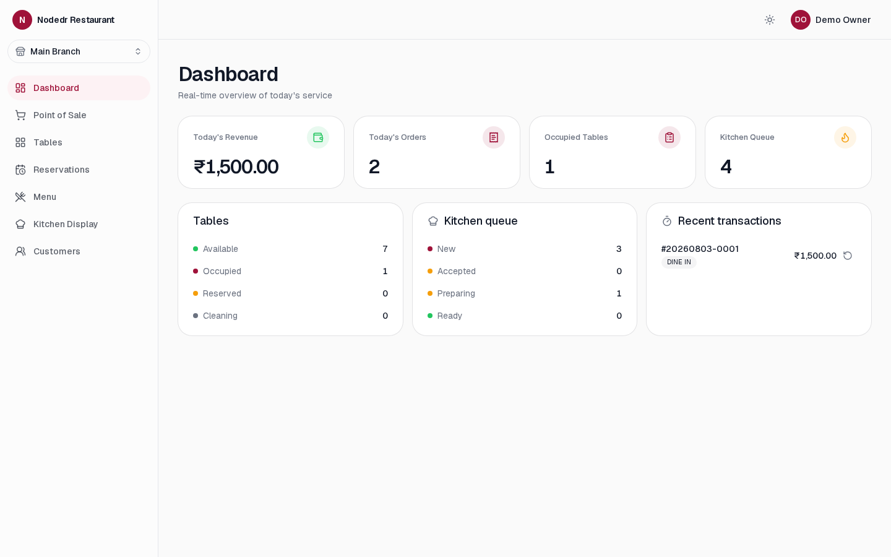 | 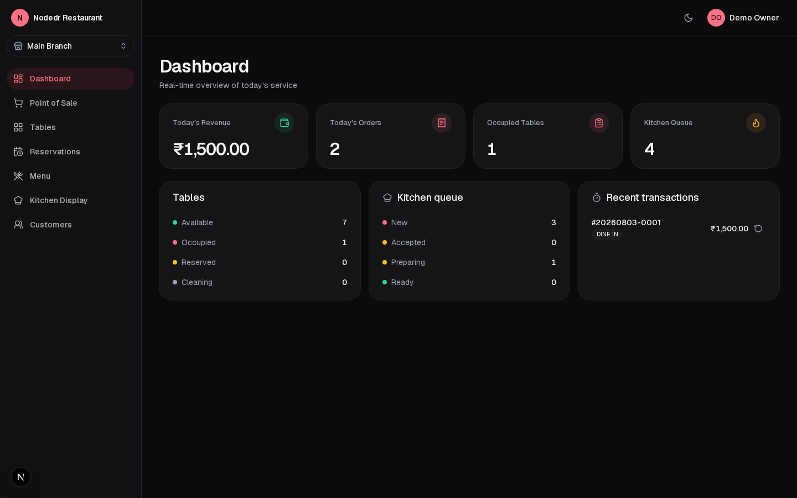 |
| Dashboard — light | Dashboard — dark |
| 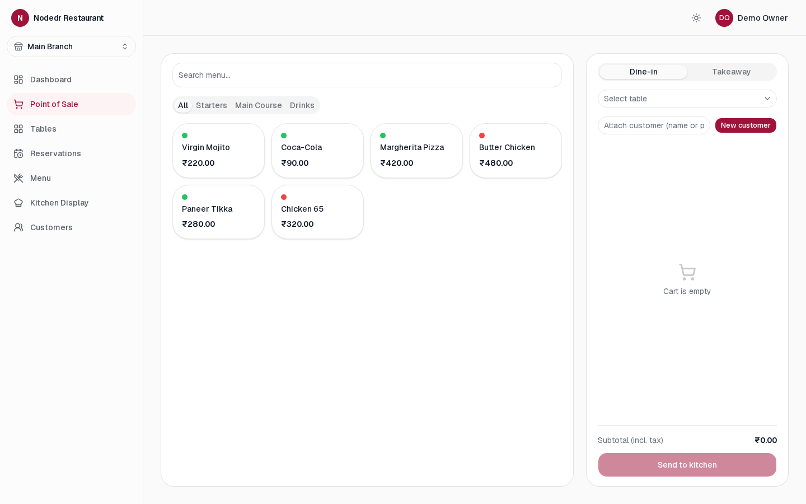 | 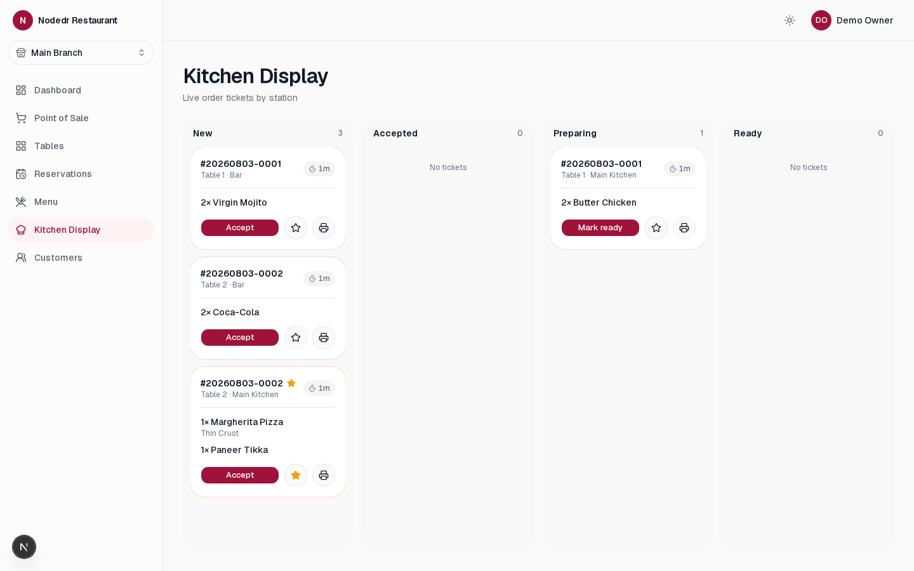 |
| Point of Sale | Kitchen Display — priority ticket, live timers |
| 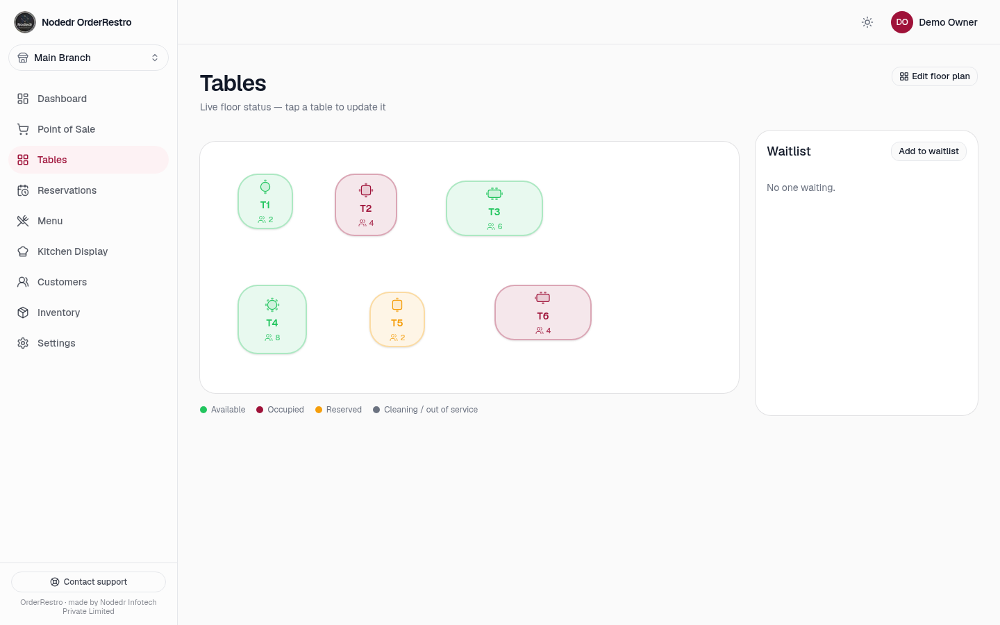 | 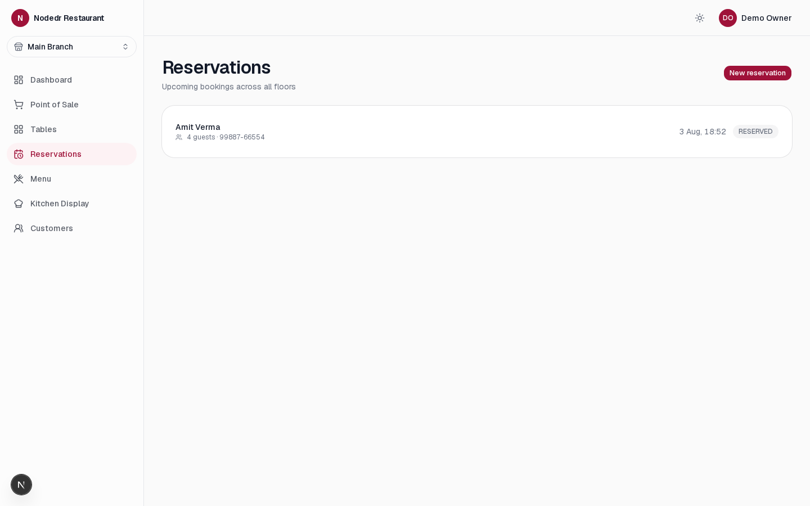 |
| Tables — floor view + waitlist | Reservations |
| 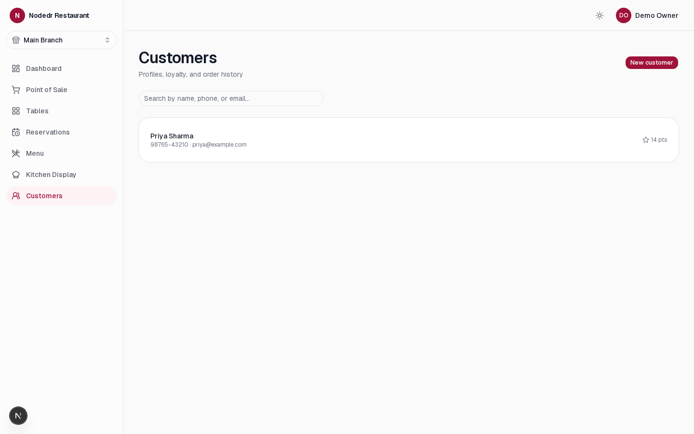 | 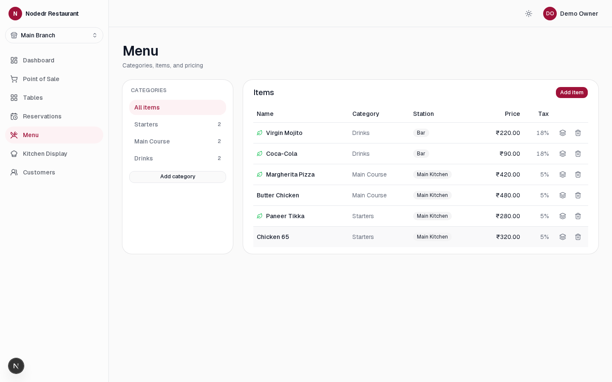 |
| Customers — CRM + loyalty | Menu management — combo builder |
| 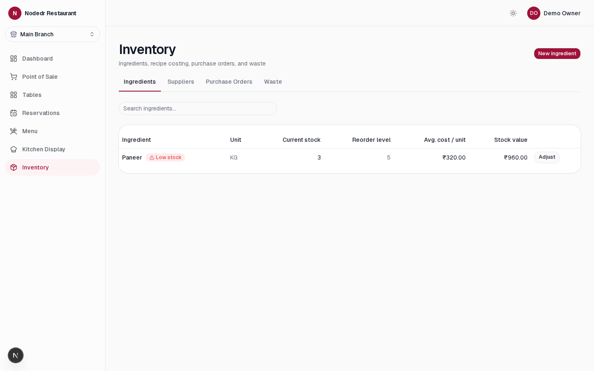 | 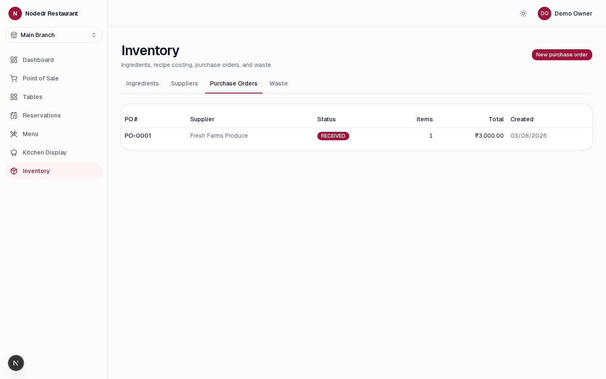 |
| Inventory — ingredients, low-stock, weighted-average cost | Purchase orders — supplier, status, total |

<details>
<summary>Mobile (390px)</summary>

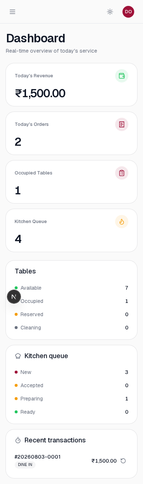

</details>

## FAQ

**Is there a free, open-source restaurant POS I can self-host?**
Yes — OrderRestro is AGPL-3.0 and installs with `docker compose up`, or as
a one-click app on CasaOS / ZimaOS.

**Does it support UPI payments and GST billing?**
Yes. Add your UPI id under *Settings → Restaurant*; checkout then shows a
scannable QR for the exact amount. GST is configured per branch, inclusive
or exclusive.

**Does it work offline?**
Order-taking, billing, the kitchen display and printing run entirely on
your local server. Only optional features (email, webhooks) need internet.

**Can it manage staff attendance and payroll?**
Yes: clock in/out, shifts, leave, payroll from clocked hours with unpaid-leave
deductions, and a tip pool split by hours worked.

**Can I export reports to Excel or PDF?**
Yes — every report exports to Excel, PDF or CSV, and can be emailed on a
daily, weekly or monthly schedule through your own SMTP server.

**What is not built yet?** Gateways beyond Razorpay, Stripe and Cashfree
(Cashfree refunds are made in the Cashfree dashboard; Razorpay and Stripe
refunds are sent from OrderRestro), direct accounting-software and
delivery-platform connectors, weighing-scale and label printers, and a SQLite
edition. Linux (`.deb`), Android and Windows (MSIX) installers exist; see
[Install](#install-orderrestro). The
[roadmap](./ROADMAP.md) is explicit about what is done and what is not.

## Tech stack

NestJS (API) + PostgreSQL/Prisma + Next.js (web) + Socket.IO (realtime) in
a pnpm/Turborepo monorepo. Full rationale for every choice — including why
NestJS over the plain-Express pattern its sister project uses, and why
Postgres over the originally-specced SQLite — is in
[`ARCHITECTURE.md`](./ARCHITECTURE.md).

| Layer | Choice |
|---|---|
| Monorepo | pnpm workspaces + Turborepo |
| Backend | NestJS (TypeScript), REST `/api/v1`, Swagger at `/api/docs` |
| ORM / DB | Prisma + PostgreSQL |
| Realtime | Socket.IO (NestJS gateway) — tables, KDS tickets, QR-order status |
| Frontend | Next.js (App Router) + TypeScript + Tailwind v4 |
| UI components | shadcn/ui (Base UI primitives), owned source, not a black-box dep |
| Data fetching | TanStack Query |
| Forms | React Hook Form + Zod (schemas shared with the backend via `packages/types`) |
| Tables | TanStack Table |
| Charts | Recharts |
| Drag & drop | dnd-kit (floor designer, KDS columns) |
| i18n | Lightweight client-side context (`apps/web/lib/i18n`) — English, Spanish, French, Italian and Brazilian Portuguese, no routing/middleware |
| Auth | JWT (httpOnly cookie) + PIN quick-switch, optional TOTP 2FA |
| Containers | Docker + Docker Compose |

## Quick start

<p align="center">
  
</p>


### One-line install (Ubuntu / Debian, amd64 and arm64)

```bash
curl -fsSL https://orderrestro.nodedr.com/install-linux.sh | sudo bash
```

Installs the `nodedr-orderrestro` .deb (runs in Docker; installs Docker if
missing). OrderRestro opens on port 1995. Direct downloads and checksums are on
the [releases page](https://github.com/Raktim94/nodedr-restaurant-pos/releases/latest).

### Installing Docker

Skip this if `docker --version` already works. Otherwise, pick your OS:

**Linux** (Debian/Ubuntu/Fedora/etc. — official convenience script):

```bash
curl -fsSL https://get.docker.com | sudo sh && sudo usermod -aG docker $USER
```

Log out and back in (or run `newgrp docker`) so your user can run `docker`
without `sudo`.

**macOS** (via [Homebrew](https://brew.sh)):

```bash
brew install --cask docker
```

Then open the Docker.app once from Launchpad/Spotlight to finish setup and
start the Docker engine — it needs to be running before `docker compose`
works.

**Windows 10/11** (via [winget](https://learn.microsoft.com/windows/package-manager/winget/), bundled with current Windows):

```powershell
winget install Docker.DockerDesktop
```

Reboot if prompted, accept the WSL2 backend if asked, then launch Docker
Desktop once from the Start menu. Run the install steps below from **WSL2**
or **Git Bash** (both include the `bash` this project's install script
needs) — plain PowerShell/cmd can't run a `.sh` file directly.

No hand-holding needed beyond that — all three ship Docker Compose v2
already bundled, which is all this project requires.

### One-click install

```bash
git clone https://github.com/Raktim94/nodedr-restaurant-pos.git && cd nodedr-restaurant-pos && ./install.sh
```

[`install.sh`](install.sh) generates a `.env` with random secrets (only if
one doesn't already exist — safe to re-run), builds the backend + web Docker
images, starts the stack, and waits up to 90 seconds for the backend to report healthy. Re-run
it any time after `git pull` to rebuild. Run `./install.sh --help` to see the
available options before starting an installation.

Open the URL printed by the installer (**http://localhost:1995** by default)
and create your restaurant at `/signup` — no demo data is loaded by default.
To try the app with sample data instead, run
`./install.sh --demo` and sign in with `owner@demo.local` / `Password123!`.

The backend API and Swagger docs are reachable only through the web app's
`/api` proxy, not published directly to the host.

### Manual install

If you'd rather run each step yourself (e.g. to set your own secrets instead
of generated ones):

```bash
git clone https://github.com/Raktim94/nodedr-restaurant-pos.git
cd nodedr-restaurant-pos
cp .env.example .env        # edit JWT_SECRET / POSTGRES_PASSWORD for anything beyond local dev
docker compose up -d --build
docker exec nodedr-restaurant-backend npx ts-node prisma/seed.ts   # optional: demo data + login; upsert-based, safe to re-run
```

### Local dev (no Docker for the apps)

Requires Node 22+, pnpm, and a local Postgres (or just run the `postgres`
service from Docker Compose).

```bash
pnpm install
docker compose up -d postgres
cp apps/backend/.env.example apps/backend/.env   # point DATABASE_URL at your Postgres
pnpm --filter @nodedr-restaurant/types build
(cd apps/backend && pnpm exec prisma migrate dev && pnpm exec prisma db seed)
pnpm dev   # runs backend (:4001) and web (:1995) together via Turborepo
```

Full setup detail, coding conventions, and the PR process are in
[`CONTRIBUTING.md`](./CONTRIBUTING.md).

### Updating

**Docker install (one-click or manual):**

```bash
git pull
./install.sh
```

Re-running [`install.sh`](install.sh) is safe any time — it never overwrites
an existing `.env` or touches existing data. It rebuilds the backend + web
images and restarts the stack; the backend runs `prisma migrate deploy`
automatically on startup, so any new database migrations from the pull are
applied before it starts accepting traffic. If you installed manually
instead, the equivalent is:

```bash
git pull
docker compose up -d --build
```

**Local dev (no Docker for the apps):**

```bash
git pull
pnpm install
pnpm --filter @nodedr-restaurant/types build
cd apps/backend && npx prisma migrate dev && cd ../..
pnpm dev
```

## Monorepo layout

```
apps/backend    NestJS API (REST /api/v1, Swagger at /api/docs, Socket.IO)
apps/web        Next.js — back-office, POS, KDS, public QR menu view
packages/types  Shared Zod schemas / TS types used by both apps
casaos/         CasaOS/ZimaOS app store manifest + assets — see casaos/README.md
docs/           Screenshots and supplementary docs
```

## Documentation

| Doc | What's in it |
|---|---|
| [`PROJECT.md`](./PROJECT.md) | Source of truth — full vision, non-negotiable principles, complete 20-module scope, current status |
| [`ARCHITECTURE.md`](./ARCHITECTURE.md) | Tech-stack decisions and the reasoning behind each one |
| [`ROADMAP.md`](./ROADMAP.md) | Phased build plan / living TODO — checkboxes are the real status |
| [`DESIGN_SYSTEM.md`](./DESIGN_SYSTEM.md) | Visual language, tokens, type scale, component inventory, per-surface UX notes |
| [`docs/CUSTOMER-DUES.md`](./docs/CUSTOMER-DUES.md) | Part payments, credit bills, the customer dues view, later payments and WhatsApp reminders |
| [`casaos/README.md`](./casaos/README.md) | CasaOS/ZimaOS one-click install, image publishing, official app store submission steps |
| [`windows/msix/README.md`](./windows/msix/README.md) | Windows MSIX desktop client — what it is/isn't, build/validate instructions, capabilities, what's CI-verified vs. not tested on real hardware |
| [`ACCESSIBILITY.md`](./ACCESSIBILITY.md) | WCAG 2.1 AA target, what's implemented, testing methodology, known gaps |
| [`COMPLIANCE-INDIA.md`](./COMPLIANCE-INDIA.md) | How the architecture relates to the DPDP Act 2023, IT Rules, GST invoicing, and CCPA dark-patterns guidelines |
| [`docs/verifactu.md`](./docs/verifactu.md) | Spain VERI*FACTU: chained invoice records, QR on the 80 mm receipt and AEAT reporting. Implemented, not certified; what is and is not verified |
| [`docs/IMPORT.md`](./docs/IMPORT.md) | Bulk-import the menu and ingredients from CSV: columns, matching rules, example files |
| [`SECURITY-AUDIT-REPORT.md`](./SECURITY-AUDIT-REPORT.md) | Full Critical/High/Medium/Low security audit findings + fixes, and Windows/MSIX Store-readiness status (what's verified vs. not tested) |
| [`docs/staff-access-tutorial.html`](./docs/staff-access-tutorial.html) ([PDF](./docs/staff-access-tutorial.pdf)) | Departments, per-person access exceptions, invoice-text reading, and install steps for every platform |
| [`docs/KIOSK-AND-KDS.md`](./docs/KIOSK-AND-KDS.md) | Customer self-service kiosk and kitchen-display (KDS) tablet setup: URL/launch, Android notes, printer/scanner status, tests |
| [`docs/integrations-api.md`](./docs/integrations-api.md) | MCP server (for AI clients) and the public integration REST API (for an external website's backend) — auth, endpoints, examples |

## Development notes

- **Server-authoritative pricing** — menu prices are tax-inclusive by
  default (India GST/EU VAT/Spain IVA); GST/VAT is backed out, never added
  on top. A branch set to `taxMode: EXCLUSIVE` (the US Sales Tax preset)
  grosses the price up to an inclusive figure at the one conversion point
  in `toEffectiveInclusiveUnitPrice` — everything downstream (stored line
  totals, receipts, refunds) still works off an inclusive amount exactly
  as before. See `apps/backend/src/modules/orders/pricing.ts` and
  `packages/types/src/tax.ts` for the regime presets.
- **Money balances are `set`, never `increment`** — any running balance
  (loyalty points, gift card balance, wallet credit) is updated via a
  rounded read-modify-write `set`; DB-side `increment` drifts on Float
  columns over many transactions.
- **Shared validation** — Zod schemas in `packages/types` drive both the
  NestJS `ZodValidationPipe` and the frontend's `react-hook-form`
  resolvers: one schema per DTO, never duplicated.
- **Realtime** — `RealtimeGateway` (Socket.IO) pushes KOT/table/order
  events into a per-branch room; the frontend's `useRealtime` hook
  invalidates the matching TanStack Query caches instead of polling.
- **Inventory costing is weighted-average**, recomputed on every goods
  receipt; waste is drawn FIFO from the oldest stock batch first, so
  cost-of-waste reporting reflects the batch that actually spoiled, not a
  blended average. See
  `apps/backend/src/modules/inventory/goods-receipts.service.ts` and
  `waste.service.ts`.
- **Order checkout deducts ingredient stock but never blocks a sale on it**
  — `StockService.consumeStock(..., allowNegative: true)` lets stock go
  negative rather than fail a paid order over a recipe-modeling gap; waste
  logging uses the same function with `allowNegative: false`, since it has
  no such urgency. See `apps/backend/src/modules/inventory/stock.service.ts`.

## Sponsor OrderRestro

OrderRestro is free: no subscription, no per-terminal fee, no paywalled features, and your data stays on your own server. It stays that way because people back it.

If it saves your restaurant time or money, please consider sponsoring. Your support pays for:

- faster releases and fixes for the bugs restaurants report
- testing on real phones, printers and kitchen hardware
- more languages, payment gateways and delivery integrations
- security reviews, dependency updates and long-term upkeep
- hosting for the website, demo and downloads

[](https://github.com/sponsors/Raktim94)

Can't sponsor? Starring the repo, telling another restaurant owner, reporting a bug or sending a translation helps just as much. Sponsoring never changes the license or unlocks hidden features. More at [orderrestro.nodedr.com/sponsor](https://orderrestro.nodedr.com/sponsor).

## Contributing

Contributions are very welcome — this is early-stage with a lot of open
scope (see the feature table above). Start with
**[`CONTRIBUTING.md`](./CONTRIBUTING.md)**: environment setup, the
non-negotiable conventions (money rounding, RBAC, shared schemas,
realtime), commit/PR process, and how to propose bigger architecture
changes without silently re-litigating a decision already recorded in
`PROJECT.md`/`ARCHITECTURE.md`.

This project follows the [Contributor Covenant](./CODE_OF_CONDUCT.md).

Thanks to everyone who has contributed: see [CONTRIBUTORS.md](./CONTRIBUTORS.md).

## License

Copyright © 2026 [Nodedr Infotech Private Limited](https://www.nodedr.com/)
and Raktim Ranjit. Licensed under the
[GNU Affero General Public License v3.0](./LICENSE) (AGPL-3.0). In short:
you're free to self-host, use, and modify this software for your
restaurant or business. If you modify it and run that modified version
as a network service for others, you must make your modified source
available to those users under the same license — this keeps
improvements to a self-hosted business tool in the open rather than
disappearing into a closed commercial fork.

See [`MAINTAINERS.md`](./MAINTAINERS.md) for project maintainers.

---

<div align="center">

</div>


## Case study

Read the [OrderRestro case study](https://www.raktimranjit.com/projects/orderrestro) for the product background and design decisions.

Maintainer: [Raktim Ranjit](https://www.raktimranjit.com/)

---

<sub>Keywords: restaurant POS, open source restaurant management software,
self-hosted POS, UPI QR payment POS, GST billing software for restaurants,
kitchen display system, KDS, restaurant inventory management, restaurant
payroll and attendance, café POS, cloud kitchen software, QR table ordering,
offline-first POS, NestJS, Next.js, PostgreSQL, Prisma, CasaOS, ZimaOS.</sub>

## Commercial licence

Licensed under the AGPL-3.0. A [commercial licence](COMMERCIAL-LICENSE.md) is available on request for use without the AGPL obligations. The NodeDR OrderRestro name and logo are not covered by the AGPL.
